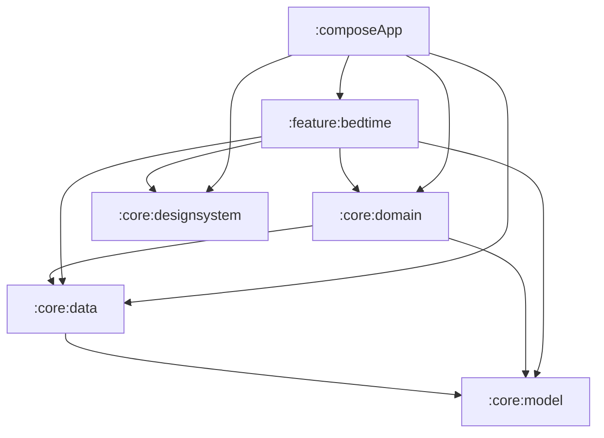

# AllSleep 아키텍처·모듈화 전환안

작성일: 2026-10-18. 상태: 현재 코드 조사에 기반한 설계 제안. 모듈 분리와 빌드 검증은 아직 수행하지 않았다.

## 목적과 기준

Google의 UI·Data·선택적 Domain 계층과 Now in Android(NiA)의 기능·공통 모듈 구성을 AllSleep에 적용한다. 핵심 목적은 로컬 기록, 화면, Android 실행 기능을 독립적으로 변경·검증할 수 있도록 만드는 것이다.

현재 Kotlin Multiplatform, Compose Multiplatform, Koin, Navigation Compose 2, Preferences DataStore를 유지한다. Android 전용 NiA의 Hilt·Room·Retrofit·WorkManager 도입은 이번 구조 개편의 전제 조건이 아니다. 라이브러리 버전 업그레이드와 저장 형식 변경도 별도 작업으로 둔다.

참고 자료:

- [Google 앱 아키텍처 가이드](https://developer.android.com/topic/architecture?hl=ko): UI와 Data가 기본이며, 복잡하거나 재사용되는 로직에 Domain을 사용한다.
- [Google 모듈화 가이드](https://developer.android.com/topic/modularization?hl=ko), [일반적인 모듈화 패턴](https://developer.android.com/topic/modularization/patterns?hl=ko): 높은 응집력, 낮은 결합력, Repository 공개 경계를 적용한다.
- [NiA Architecture Learning Journey](https://github.com/android/nowinandroid/blob/main/docs/ArchitectureLearningJourney.md): Repository·Flow·단방향 데이터 흐름을 참고한다. 이 문서는 Google 아키텍처와 다른 Clean Architecture 해석을 구분한다.
- [NiA Modularization Learning Journey](https://github.com/android/nowinandroid/blob/main/docs/ModularizationLearningJourney.md): 앱 조립, 기능별 UI, 공통 모듈의 책임을 참고한다. 확인한 main 문서는 feature의 api/impl 분리도 설명한다. AllSleep에서는 루트 내비게이션과 콜백으로 충분한 동안 추가 분리를 보류한다.

위 링크는 2026-10-18에 읽은 공식 공개 문서이며 main은 변경될 수 있다. 사용자가 언급한 첨부 MD의 본문·파일은 이번 대화와 저장소에서 확인하지 못했으므로 첨부본과 동일한 버전이라고 간주하지 않는다.

## 현재 코드에서 확인한 점

경로는 저장소 루트 기준이다.

| 현재 상태 | 근거 | 전환 시 처리 |
| --- | --- | --- |
| Gradle 모듈은 `:composeApp` 하나 | `settings.gradle.kts` | 공통 책임부터 별도 Gradle 모듈로 추출 |
| UI·Repository·UseCase 패키지는 이미 분리 | `composeApp/src/commonMain/kotlin/com/wngud/allsleep/` | 기존 구현과 테스트를 이동하고 필요한 경계만 변경 |
| 네 탭이 `LocalBedtimeScreen`과 `LocalBedtimeViewModel` 타입을 재사용 | `navigation/AppNavigation.kt`, `ui/bedtime/` | 초기에는 하나의 취침 기능 모듈. 동일 ViewModel 인스턴스를 공유한다고 가정하지 않음 |
| 로컬 설정과 저널이 하나의 DataStore 사용 | Android `di/AppModule.kt`, 공통 `data/repository/LocalBedtimeRepositoryImpl.kt` | 동일 인스턴스·파일·키·원자적 갱신 보존 |
| Repository 계약 일부가 플랫폼 타입에 의존 | `domain/repository/AuthRepository.kt`, `BillingRepository.kt` | 로그인·결제 화면 실행 경계와 데이터 계약을 구분한 뒤 이동 |
| Google 로그인은 앱 리소스에 의존 | Android `data/datasource/auth/GoogleAuthDataSource.kt` | 앱이 client ID를 읽고 생성자/설정으로 전달 |
| 결제 구현은 앱 BuildConfig에 의존 | Android `platform/BillingProviderImpl.kt` | 앱에서 설정을 읽어 구현에 주입 |
| 서비스 컨트롤러·예약·오버레이가 앱 Service/Receiver를 참조 | Android `platform/` | 처음에는 앱에 유지. 모듈을 역참조하지 않도록 경계 정리 |
| expect/actual 시간 함수가 model 패키지에 존재 | 각 소스 세트의 `domain/model/TimeUtils.kt` | 단순 모델과 분리해 호출 목적별 시간 계산·표시 책임으로 이동 |
| 검증 스크립트가 앱 모듈의 테스트만 실행 | `verify.sh` | 이동한 모듈의 테스트·Lint를 명시적으로 포함 |

현재 작업 공간에 V2-01~03을 포함한 다수의 미커밋 변경이 있다. HEAD만 복제한 작업 공간에는 현재 제품 상태가 없을 수 있다. 구현 시 현재 파일을 기준으로 작업하고 기존 변경의 삭제·되돌리기·일괄 커밋을 하지 않는다.

## 1차 목표 구조

V2-04 전후의 최소 유용한 분리 목표다. 아래 모든 모듈이 현재 존재하는 것은 아니다.

| 모듈 | 책임 | 주요 이동 대상 |
| --- | --- | --- |
| `:composeApp` | Android/iOS 진입점, 루트 내비게이션, 앱 수준 DI 조립, 아직 추출하지 않은 플랫폼·계정 기능 | `App`, `AppRootViewModel`, `MainActivity`, `AllSleepApp`, `MainViewController`, 루트 탐색 |
| `:core:model` | 플랫폼 UI에 의존하지 않는 공개 모델과 모델 자체의 불변 조건 | `BedtimeModels`, `SleepRecord` 등 공통 모델, 관련 순수 테스트 |
| `:core:data` | 로컬 Repository 계약·구현, DataStore 생성·접근, 저널 코덱, 데이터 갱신 규칙 | `LocalBedtimeRepository`, `SleepSettingsRepository`, 구현, 코덱, 저장 테스트 |
| `:core:domain` | 여러 Repository 조합 또는 복잡한 업무 흐름의 UseCase | 의존성 정리가 끝난 계산·조합 UseCase와 테스트. 단순 전달용 UseCase의 일괄 생성은 하지 않음 |
| `:core:designsystem` | 테마, 색상, 타이포그래피, 버튼·카드·입력 같은 공통 UI | `ui/theme`, 데이터에 의존하지 않는 `BedtimeComponents` |
| `:feature:bedtime` | 오늘·루틴·기록·마이의 현재 로컬 사용 흐름, 상태와 화면 | `ui/bedtime`, 해당 ViewModel 테스트, 기능 전용 리소스 |

KMP 라이브러리는 현재 앱과 일치하는 Android·iosArm64·iosSimulatorArm64 타깃을 유지한다. `:core:model`은 Compose나 플랫폼 화면 컨텍스트에 의존하지 않는다. `:core:data`의 DataStore expect/actual은 함께 이동한다. Android 전용 Firebase 구현을 commonMain에 넣지 않는다.

화살표는 허용하는 Gradle 의존 방향이다. 모든 기능이 모든 의존성을 반드시 가져야 한다는 뜻은 아니다. Repository 인터페이스는 Data의 공개 API로 제공하고, 구현·데이터 소스·코덱은 가능한 범위에서 internal로 숨긴다. Domain이 Data의 공개 Repository 계약에 의존하는 구조는 사용자가 요청한 Google/NiA 방식을 따른다.

Data는 Domain UseCase를 호출하지 않는다. Repository가 필요한 상태 전이·검증은 모델의 순수 규칙이나 Data 내부 규칙으로 유지해 순환을 막는다. 데이터 스키마 표현과 UI용 표시 모델은 필요할 때 분리하되, 의미가 같은 모델을 계층마다 기계적으로 복제하지 않는다.

## 이후 기능 분리

1차 분리 후 아래 경계로 확장한다. V2 제품 구현과 별도의 구조 작업으로 추적하며, 새 폴더 생성만으로 해당 제품 단계를 완료 처리하지 않는다.

- `:feature:today`, `:feature:routines`, `:feature:records`, `:feature:my`: 실행 준비·편집·기록 탐색·계정 연결의 상태와 테스트가 독립적으로 커질 때 `:feature:bedtime`을 나눈다. 네 탭 사이의 공통 데이터는 Repository로 공유하고 ViewModel을 교차 참조하지 않는다.
- `:feature:auth`, `:feature:subscription`, `:feature:onboarding`: 기존 연결과 화면 실행 계약을 정리한 뒤 각각 이동한다. 현재 사용 중인 계정 설정 진입과 구매 복원 경로를 보존한다.
- `:core:data`의 계정·동기화 구현: 앱 리소스·화면 컨텍스트 의존성을 정리한 뒤 androidMain으로 이동한다. 독립 변경이 실제로 많아지면 `:data:account`, `:data:bedtime` 등 업무별 분리를 검토한다.
- 제한 실행 모듈: V2-04~06에서 로컬 세션과 OS 실행 확인 계약을 먼저 확정한다. 계약은 기능에서 구현을 알 필요가 없는 위치에 두고, Android Service·Receiver·예약 구현은 함께 옮긴다. 구현이 Repository 또는 Domain을 사용하더라도 Data가 그 Android 구현을 역참조하지 않게 한다.

초기에는 `core:common`, `core:network`, `core:database`, `core:testing`, 기능별 api/impl을 관례만으로 만들지 않는다. 공통 테스트 Fake가 여러 모듈에서 실제로 중복되거나 구현 교체·빌드 격리 요구가 생기면 그때 도입한다.

## 상태·화면·DI 규칙

- ViewModel은 Repository 또는 필요한 UseCase에서 데이터를 받고 읽기 전용 StateFlow로 UI 상태를 제공한다. 단순 저장에 전달용 UseCase를 강제하지 않는다.
- Route는 ViewModel 연결과 상태 수집을 담당하고, Screen은 상태와 콜백을 받는다. 기능 간 이동은 앱의 루트 내비게이션이 조정한다. 기능이 다른 기능의 ViewModel이나 앱의 Screen 상수를 참조하지 않도록 한다.
- 여러 탭에 필요한 기록·설정의 원본은 Repository다. 탭별 로딩·편집·표시는 각 기능의 상태다. 공통 ViewModel을 앱 전역 singleton으로 등록해 공유하지 않는다.
- 저장 성공·실패와 재시도에 필요한 정보는 관찰 가능한 상태로 남긴다. 기존 이동·알림 처리의 전달 보장은 별도로 검토하며 모듈 이동과 동시에 전체 MVI 방식을 교체하지 않는다.
- Koin 정의는 해당 모듈의 구현에 인접하게 두고 앱에서 조립한다. 같은 DataStore를 여러 모듈에서 생성하지 않는다. 앱 소유의 키·client ID·빌드 설정은 앱에서 읽어 필요한 구현에 전달한다.
- `PlatformContext`나 Compose `remember…`가 들어 있는 파일을 그대로 순수 모델/Domain 모듈에 넣지 않는다. 화면을 띄우는 어댑터와 공통 계약을 분리한다. expect/actual은 동일 KMP 모듈의 올바른 소스 세트로 함께 옮긴다.
- Compose 리소스는 사용하는 기능 또는 디자인 시스템이 소유한다. 라이브러리에서 앱의 `allsleep.composeapp.generated.resources`를 참조하지 않는다. 공통 공개 리소스 접근이 필요하면 해당 모듈의 Compose 리소스 공개 설정과 생성 패키지를 확인한다.

## 구현 순서와 완료 조건

각 단계는 컴파일 가능한 단위로 종료한다. 순수 이동과 의미 변경을 분리하고, 기존 테스트를 코드 소유 모듈로 같이 옮긴다.

| 단계 | 작업 | 완료 조건 |
| --- | --- | --- |
| M0 | 현재 작업 트리의 변경 목록과 기존 검증 기준 확보 | 현재 상태에서 `./verify.sh` 실행, 기존 실패와 신규 실패를 구분. 이 문서 작성에서는 실행하지 않음 |
| M1 | 모델·디자인 시스템 추출 | `core:model`, `core:designsystem` 연결, 앱 컴파일, 모델 테스트, 리소스 참조 확인 |
| M2 | 로컬 Data 추출 | Repository 계약·구현·코덱·DataStore expect/actual 이동. 메모리 테스트와 실제 디스크 재열기 테스트 통과 |
| M3 | 필요한 Domain 추출 | 모델·Repository 계약만 사용하는 UseCase 이동. 플랫폼 의존 UseCase는 경계 정리 전까지 앱에 유지. 호출부 테스트 통과 |
| M4 | 현재 취침 기능 추출 | `feature:bedtime` 화면·ViewModel·리소스·DI 이동. 네 탭 이동, 편집·실패·재시도, 로그인 연결 보존 |
| M5 | 계정·결제·온보딩 경계 정리와 기능 추출 | 앱 R/BuildConfig 의존 제거, 화면 실행 계약 정리, 해당 단위 테스트와 계측 검증. 실제 결제는 별도 환경 검증 |
| M6 | 새 실행 계약에 따른 플랫폼 구현 분리 | V2-04~06와 연계. 시작 요청/실행 확인, 해제 요청/완료 확인, 긴급 접근·예정 해제의 실기기 검증 |

KMP 라이브러리의 타깃·JVM 17·SDK·테스트 설정 반복이 생기는 M1에서 작은 convention plugin을 도입할 수 있다. 현재 버전을 유지하며 필요한 KMP/Compose 설정만 공유하고 NiA의 전체 build-logic을 복사하지 않는다.

`verify.sh`는 M1부터 모듈별 실제 생성된 task를 확인해 수정한다. `:composeApp:testDebugUnitTest`만 실행하면 옮겨진 라이브러리 테스트가 빠질 수 있다. 앱 컴파일·Lint와 함께 추가된 Android 라이브러리의 `testDebugUnitTest` 및 해당 Lint를 실행하도록 한다. task 이름은 도입한 플러그인에서 확인한다.

## 데이터·플랫폼 회귀 검증

반드시 보존할 항목:

- Android DataStore의 `allsleep_settings` 이름과 기존 `allsleep_settings.preferences_pb` 파일, Preferences 키와 `local_bedtime_journal_v1` 형식.
- 최초 생성한 로컬 소유자, 세션 ID, 회차의 날짜·시간대·절대 시각, 기존 원본 기록.
- 손상 데이터·미지원 버전에서 원본을 지우지 않는 오류·재시도 경로.
- 닫힌 확인 구간만 합산하는 기록 규칙과 로그인 시 게스트 기록을 자동 병합하지 않는 규칙.
- Android applicationId, 공개된 Service/Receiver 클래스 이름, PendingIntent 식별 요소. 모듈 이동을 이유로 OS 등록 식별자를 바꾸지 않는다.
- 앱 진입의 로컬 초기화와 인증 실패의 독립성.

기존 테스트의 이동 기준:

| 기존 테스트 | 대상/검증 의미 |
| --- | --- |
| `BedtimeSessionTest` | 모델의 상태 전이, 시간 계산과 원본 보존 |
| `LocalBedtimeRepositoryTest` | Data의 원자적 갱신·중복 명령·복구 |
| `LocalBedtimeDiskTest` | Data androidUnitTest의 실제 파일 재열기 |
| `LocalBedtimeViewModelTest` | 취침 기능의 로딩·저장·실패 |
| `AppRootLocalInitializationTest` | 앱 진입과 로컬 초기화 |
| `BedtimeFoundationUiTest` | 우선 앱의 통합 계측 위치 유지, 네 탭·편집·렌더링 확인 |

각 단계에서 Android 컴파일·관련 테스트를 실행하고, 분리 완료 시 전체 검증과 APK 조립을 실행한다. UI를 이동해도 실제 렌더링·큰 글꼴·키보드·시스템 영역은 확인한다. 개인 기기에서는 업데이트 설치로 데이터를 보존한다.

iOS 타깃의 컴파일·프레임워크 연결은 Xcode/Kotlin Native 환경이 있을 때 확인한다. 현재 iOS 제품 기능의 완성 여부와 이번 모듈화의 빌드 호환성은 별도로 기록한다. Android 성공만으로 iOS 검증을 완료 처리하지 않는다.

## 제품 로드맵과 문서 관리

M0~M4는 V2-01~03의 동작을 유지하며 다음 구현의 경계를 준비한다. V2-04~06의 실제 앱 제한·권한·예약 구현을 이 리팩토링 결과로 오인하지 않는다. M5와 나머지 세분화가 핵심 제품 검증을 장기간 막지 않도록 각 단계의 실제 이득을 확인한다.

구현 단계가 끝날 때 실제 모듈·검증 명령을 루트 `AGENTS.md`에 반영하고 `IMPLEMENTATION-STATUS.md`에 구조 작업과 제품 단계 상태를 구분해 기록한다. 이 설계안만으로 현재 아키텍처 설명이나 제품 완료 상태를 변경하지 않는다.

현재 확인 결과: 공식 문서와 로컬 코드의 의존 관계를 조사했다. 소스·Gradle·사용자 데이터 변경, 빌드·단위 테스트·실기기 검증은 수행하지 않았다.
